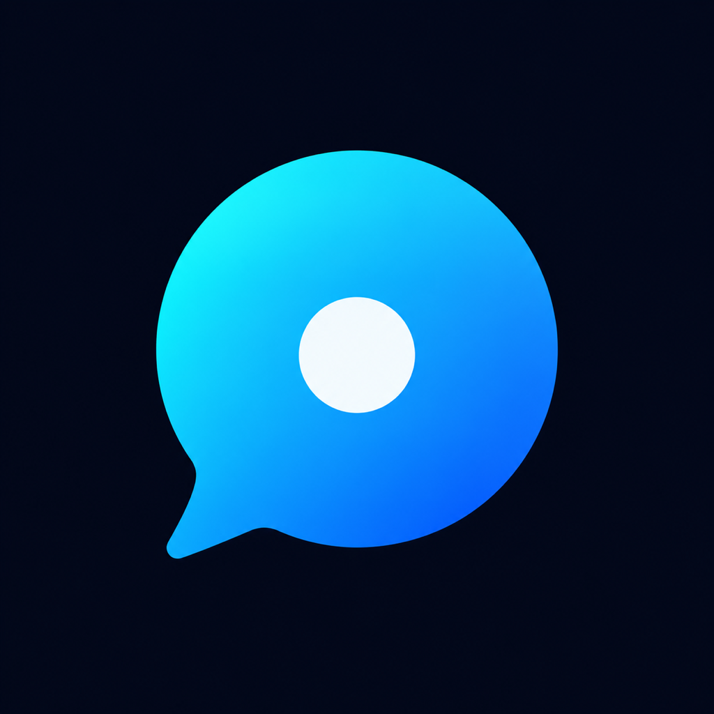
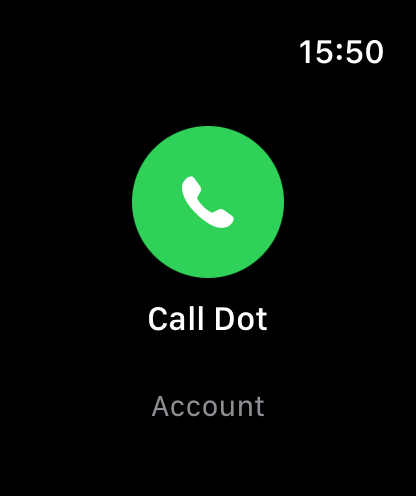
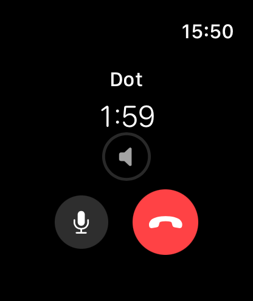
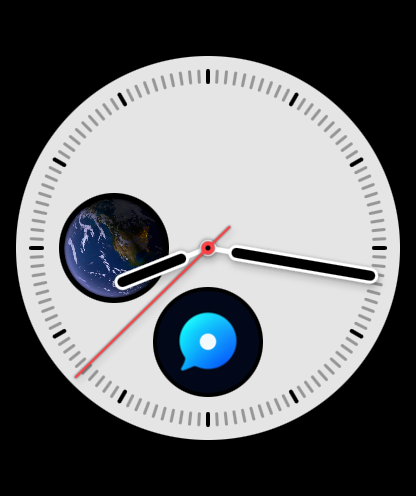

# WatchDot

A standalone Apple Watch client for continuous voice conversations with the Dot already available in your ChatGPT account.



WatchDot runs on the Watch. A nearby paired iPhone can provide Internet through the system connection; no WatchDot iPhone app or Mac voice relay is required.

## Features

- Account authorization by a code shown on the Watch and approved in your browser.
- Continuous microphone and speaker audio with interruption handling.
- Call duration, local volume, mute/unmute and one-action hang-up.
- An original generated waiting tone, with the existing one-second tone / three-second silence cadence.
- A circular or corner watch-face shortcut that opens WatchDot.
- CallKit-managed audio and direct, encrypted ICE-TCP media.

## Screenshots

| Home screen | Call controls | Watch-face shortcut |
| :---: | :---: | :---: |
|  |  |  |

Captured in watchOS Simulator. The home and call screens use the app's preview modes. On the Infograph face, the bottom circular WatchDot icon opens the app. All interface text is in English.

## Requirements

- A Mac with Xcode and a compatible watchOS SDK. The project was built with Xcode 26.6 / watchOS SDK 26.5.
- A physical Apple Watch running watchOS 11 or later, paired with an iPhone. Device validation used an Apple Watch Series 8.
- Your own Apple account for development signing. A paid developer membership is not required for personal device testing, but free provisioning must be renewed periodically.
- A ChatGPT account that already has access to Dot. This project does not enable Dot for accounts without that feature.

The bundled native libraries cover physical Watch `arm64_32` / `arm64` and Apple Silicon Watch simulator `arm64`. Installing from source does not require Rust. Rebuilding the native libraries does.

## Install

1. [Download the ZIP](https://github.com/El-Roque/WatchDot/archive/refs/heads/main.zip) or clone the repository, then extract it to a local folder.
2. Open [`src/WatchDot.xcodeproj`](src/WatchDot.xcodeproj) in Xcode.
3. Configure **your own team and unique identifiers for both targets**.
4. Select the **WatchDot** scheme and your physical Watch, then build and run.
5. Authorize your ChatGPT account from the Watch and browser.

You can also clone the public repository:

```sh
git clone https://github.com/El-Roque/WatchDot.git
```

Follow the [installation guide](docs/INSTALLATION.md) for signing, developer mode, account connection and watch-face setup. The download is source code, not an App Store or universally signed installer.

## Use

Keep the paired iPhone nearby with Bluetooth and Internet available. Open WatchDot, start a call, then use the microphone, volume and end controls. The shortcut opens the app; it does not start a call automatically.

The interface is in English. Account authorization and calls always require an explicit action. Tokens stay in the app's own Keychain. Do not paste passwords, tokens or account authorization codes into GitHub issues.

## Development

```sh
swift test --package-path src
python3 scripts/check_project.py
```

The Xcode project is checked in and ready to open. It can be regenerated with:

```sh
python3 scripts/generate_project.py
```

See [architecture](docs/ARCHITECTURE.md), [native build instructions](src/Native/README.md), and [validation](docs/VALIDATION.md).

## Status and limitations

The Watch-only conversation, nearby-iPhone connectivity with Wi-Fi disabled, locked-iPhone / wrist-down continuity, one-action hang-up, app icon and face shortcut were validated on physical devices. The final test succeeded after the original iPhone and companion Watch apps had been removed.

The current source is version 1.0, build 4. The project owner accepted the English interface and compact circular controls, confirmed improved first-response behavior in build 4 on Watch Wi-Fi, and previously validated build-2 incoming-audio fluency and the renamed face shortcut. The predecessor app has been removed. See [validation](docs/VALIDATION.md) for the per-build evidence, the earlier accepted baseline and the limits of this single-device test.

This is an unofficial project using an experimental, private Dot protocol. It is not an official Apple or OpenAI app, is not the public paid Realtime API, and may stop working if the service changes. Access and behavior were validated with one account; availability for other accounts is not guaranteed. The simulator does not prove Bluetooth routing or physical microphone/speaker behavior. See the validation document for the exact limits and for changes made during packaging.

## Publishing this source

See the [publication checklist](docs/PUBLISHING.md). Use Git or GitHub Desktop for the bundled libraries; no repository is published automatically.

## License and credits

WatchDot is distributed under **GPL-3.0-only**, preserving the license of [Torcata/watch-dot](https://github.com/Torcata/watch-dot), revision `0ca53cc050017533e5ed8aef0436fc32e20f2ba1`.

See [LICENSE](LICENSE), [NOTICE](NOTICE), and [third-party notices](src/Vendor/Notices/INDEX.json). Native components include OpenClaw-derived code, str0m and libopus under their respective licenses. The waiting sound is generated from mathematical oscillators by the included script; no extracted ChatGPT audio or desktop-client artifacts are distributed.
